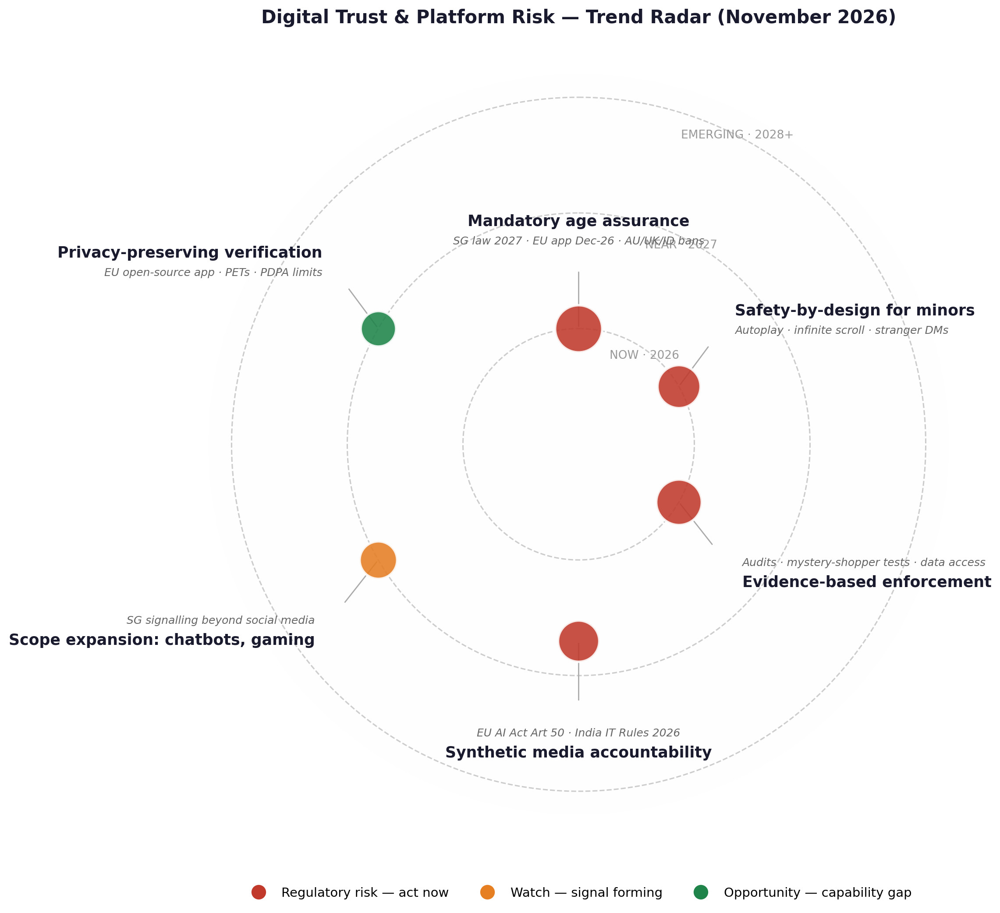

# Emerging Digital Trust & Platform Risk — Horizon Scan

*November 2026 · Portfolio demonstration of horizon scanning, trend analysis, and data-driven platform assessment*

**Purpose.** Scan regulatory and platform signals across Singapore, the EU, UK, Australia and Asia-Pacific (Nov 2025 – Nov 2026) to identify the digital-trust risks and regulatory shifts most likely to shape platform governance through 2028 — and to demonstrate a repeatable, data-driven method for assessing platform practices against established standards.

## Three trends to watch

| Trend | Key signals (Nov 2025 – Nov 2026) | Regulatory implication for Singapore | Horizon |
|:---|:---|:---|:---|
| **1. Mandatory age assurance becomes the baseline** | **SG:** minimum age 13 to be enforced for six designated social media services (NDR Aug-26); legislation planned early 2027; self-declaration ruled insufficient.[^1][^2] **EU:** open-source age-verification app; member-state target Dec-26.[^3] **AU:** under-16 ban live since Dec-25 (4.7M accounts removed); **ID** followed Mar-26; **UK** legislated under-16 ban from Mar-27.[^4][^5][^6] | Age assurance shifts from policy checkbox to *tested control*. Singapore's outcome-based model — platforms propose methods, IMDA tests effectiveness — demands robust, privacy-preserving (PDPA-compliant) verification with re-verification.[^1][^2] | Now |
| **2. Safety-by-design obligations for minors** | **SG:** proposed teen safeguards target design features — stranger-DM restrictions, autoplay and infinite-scroll limits, algorithmic-feed safeguards, daily time limits; non-compliant platforms face a minimum age raised to 18.[^1][^2] **EU:** TikTok preliminary DSA breach finding on addictive design (Feb-26); Commission minors guidelines (Jul-25) name infinite scroll and autoplay as risks.[^3] | Engagement mechanics become *regulated design features*. Platforms need differentiated teen experiences plus evidence that safeguards work — not policy statements. | Now |
| **3. Synthetic media accountability** | **EU:** AI Act Art. 50 duties (machine-readable marking, visible deepfake labels) enforced from Aug-26.[^7] **CN:** AI-content labelling in force Sep-25. **IN:** IT Rules 2026 mandate labelling, provenance and three-hour takedowns (from Feb-26).[^8][^9] | Provenance and labelling are moving from voluntary to mandated. With scam and impersonation volumes rising, verification of synthetic-media controls is a near-term assessment priority for Singapore. | Now → Near |

**Also on the radar.** *Scope expansion* is the signal to watch: Singapore has indicated safeguards may extend beyond social media to AI chatbots, gaming and messaging services.[^2] *Privacy-preserving verification* is the opportunity space — the EU's open-source age-verification app uses a double-blind design, and Australia's framework prohibits compulsory government-ID checks, pointing to privacy-enhancing technologies as the compliance-friendly path.[^3][^4]

**The common thread — enforcement is now evidence-based.** Regulators no longer accept attestations: the EU fined X €120M (Dec-25) over transparency obligations including researcher data access[^10] and preliminarily found Meta in breach for ineffective under-13 controls (Apr-26);[^3] Australia's eSafety issued 23 legally enforceable information-gathering notices to 10 platforms, documented "poor practices" and opened investigations into five platforms.[^14] IMDA already works this way — mystery-shopper testing of 7,000+ apps under the App Distribution Services Code found 65 harmful apps, 24 mis-rated apps and one store's age-assurance method being circumvented.[^11] **Bottom line: in 2026–27, assessment frameworks add value by testing demonstrable outcomes — effectiveness, audit evidence, privacy-preserving implementation — not by reviewing written policies.**

---

# Annex A — Platform Practice Assessment Framework (PPAF)

Five dimensions distilled from public regulatory expectations: Singapore's Code of Practice for Online Safety and App Distribution Services Code, EU DSA Arts. 25/34/35/39/40, Australia's "reasonable steps" standard, and PDPA. Maturity scale: **1** Ad hoc · **2** Developing · **3** Defined · **4** Managed · **5** Optimising.

| Dimension | What it tests | Public anchors |
|:---|:---|:---|
| **D1 Effectiveness** | Control works in practice — tested and measured, not asserted | SG outcome-based age assurance; AU "reasonable steps"; eSafety poor-practice findings[^1][^4][^13] |
| **D2 Privacy & proportionality** | Data collection minimised, proportionate to risk | PDPA duties for age assurance; AU ban on compulsory government ID; EU double-blind app[^1][^3][^4] |
| **D3 Transparency & accountability** | Practices disclosed honestly and completely | DSA Arts. 25/39/40; X €120M fine (deceptive design, ad repository, data access)[^10] |
| **D4 Verifiability & audit evidence** | Regulator can independently test and reproduce results | IMDA mystery-shopper testing; DSA audits; eSafety powers expanded Sep-26[^11][^12] |
| **D5 User redress & reporting** | Users can report harm and obtain timely remedy | SG Online Safety Commission (from Jun-26); Meta's 7-click underage-reporting flow criticised[^1][^3] |

## Assessment of three live platform practices (industry-level)

| Practice | D1 | D2 | D3 | D4 | D5 | Overall | RAG |
|:---|:--:|:--:|:--:|:--:|:--:|:--:|:--:|
| P1 · Age gates based on self-declaration only | 1 | 4 | 2 | 1 | 2 | **2.0** | Red |
| P2 · Default-on engagement mechanics for minors | 2 | 3 | 2 | 2 | 2 | **2.2** | Red |
| P3 · Synthetic-media labelling without provenance | 2 | 4 | 3 | 2 | 3 | **2.8** | Amber |

**P1 — Self-declaration age gates (Red, 2.0).** Fails in practice: a BMJ-published University of Newcastle study (Jun-26) found over 85% of under-16s still using restricted platforms after Australia's ban, with the most common age check being simple self-declaration;[^15] the Commission's Meta finding cited unchecked false birth-dates.[^3] eSafety flagged platforms letting self-declared minors "re-verify" via low-confidence methods or retry without escalation.[^5] *Follow-up:* layered "waterfall" assurance (inference → estimation → verification), re-verification on risk signals, independent effectiveness testing with published results.

**P2 — Default-on engagement mechanics for minors (Red, 2.2).** Singapore's MOH expert panel (Jul-26) flagged direct messaging, infinite scroll, autoplay and algorithmic feeds as risk features;[^11] the EU treats addictive design as a systemic risk (TikTok finding).[^3] *Follow-up:* default-off autoplay and stranger messaging for minors with parent-adjustable settings; differentiated teen experiences; measured safeguard-efficacy reporting.

**P3 — Synthetic-media labelling without provenance (Amber, 2.8).** Labels alone are forgeable — China prohibits label removal,[^8] the EU requires machine-readable marking from Aug-26,[^7] India requires provenance embedding where feasible.[^9] *Follow-up:* C2PA-style content credentials; labels immutable across re-shares; detection-accuracy disclosure for auditability.

---

# Annex B — Methodology, limitations and sources

**Method.** (1) *Signal collection:* regulator publications, parliamentary answers, enforcement decisions, statutes and reputable legal/industry trackers across seven jurisdictions, Nov-25 – Nov-26. (2) *Clustering:* signals grouped into six candidate trends; momentum scored by volume, seniority and binding force of actions. (3) *Radar plotting:* horizon (Now / Near / Emerging) × posture (risk / watch / opportunity). (4) *Assessment:* PPAF dimensions derived from the same public regulatory expectations; maturity scores are analyst judgements against cited evidence.

**Limitations.** Public sources only; point-in-time as of November 2026; scores are structured judgements, not audit findings; no privileged platform data. Designed to be re-run quarterly as signals evolve.

[^1]: BusyParents.sg, "Social Media Age Limit in Singapore: What Changes at 13" (17 Oct 2026) — summarising NDR 2026, MDDI's 8 Sep 2026 parliamentary answer and MDDI's Jul 2026 factsheet. busyparents.sg
[^2]: Baker McKenzie, "Singapore: Government Proposes to Legislate Stronger Social Media Safeguards" (29 Sep 2026). bakermckenzie.com
[^3]: Usercentrics, "EU and UK Age Verification Compliance: Laws and Risks" (16 Sep 2026). usercentrics.com
[^4]: Australian eSafety Commissioner, "Social media 'ban' or delay FAQ" (updated 30 Sep 2026). esafety.gov.au
[^5]: AU10TIX, "Australia Social Media Ban: Under-16 Age Verification Rules 2026" (17 Aug 2026). au10tix.com
[^6]: Wikipedia, "Online age verification laws by country" (accessed Nov 2026). en.wikipedia.org
[^7]: Resemble AI, "Deepfake Laws and Regulations by Country" (accessed Nov 2026) — EU AI Act Art. 50 duties from 2 Aug 2026. resemble.ai
[^8]: NeuralDefend, "Are Deepfakes Illegal? Laws by Country in 2026" (14 Aug 2026). neuraldefend.com
[^9]: Legal500, "IT Rules 2026 Deepfake Regulation: Three Hour Takedowns and AI Labelling Obligations" (18 Mar 2026). legal500.com
[^10]: Loyens & Loeff, "DSA enforcement in practice: from rules to commitments and fines" (10 Jun 2026). loyensloeff.com
[^11]: Mothership.sg, "S'pore govt to introduce legislation in early 2027 to strengthen safeguards for young social media users" (Oct 2026) — IMDA mystery-shopper testing results; MOH expert panel findings. mothership.sg
[^12]: Australian eSafety Commissioner, "Social media age restrictions" (2026) — Strengthening Enforcement Bill passed 10 Sep 2026. esafety.gov.au
[^13]: Tech Policy Press, "Early Lessons from Australia's Teen Social Media Ban" (1 Apr 2026). techpolicy.press
[^14]: Australian eSafety Commissioner, "Social Media Minimum Age: Compliance Update" (Mar 2026) — 23 legally enforceable information-gathering notices to 10 platforms; poor-practice observations; five platforms under investigation. esafety.gov.au
[^15]: C. Barnes et al., "Assessing early effects of Australia's Social Media Minimum Age Act on adolescents' social media use: observational study," BMJ (24 Jun 2026) — >85% of under-16s still using restricted platforms at follow-up; most common age check was self-declared age. bmj.com
