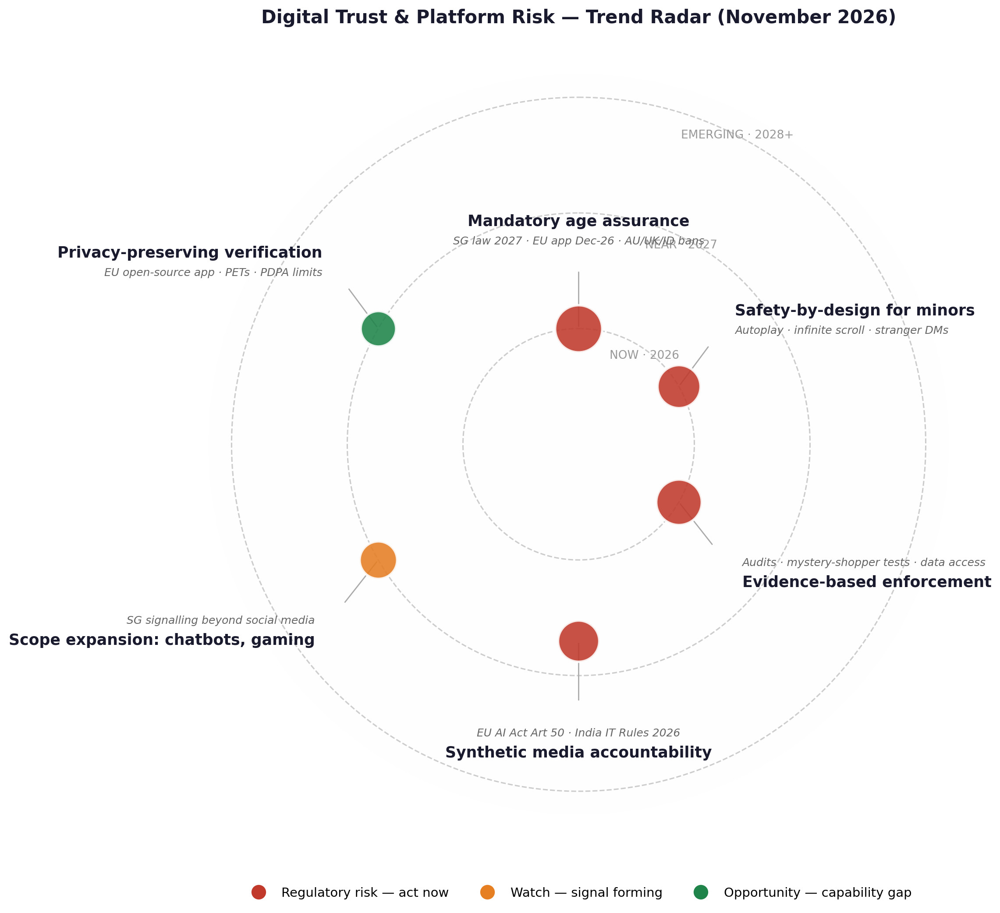

# Emerging Digital Trust & Platform Risk — Horizon Scan (November 2026)

A horizon scan of digital-trust and platform-safety regulation across seven jurisdictions, paired with an original five-dimension assessment framework applied to three live platform practices. Built entirely on public, dated sources — 15 footnoted references including regulator publications, parliamentary answers, enforcement decisions and a BMJ-published study.

## What this demonstrates

- **Horizon scanning & research** — signal collection and clustering across Singapore, the EU, UK, Australia, Indonesia, India and China (Nov 2025 – Nov 2026), plotted on a trend radar by horizon and regulatory posture.
- **Data-driven assessment framework design** — the Platform Practice Assessment Framework (PPAF): five dimensions (effectiveness, privacy & proportionality, transparency, verifiability, user redress) with a 1–5 maturity scale, derived from public regulatory expectations.
- **Evidence-based regulatory judgement** — three industry-level practices scored with cited evidence and concrete follow-up actions.
- **Senior-stakeholder communication** — a one-page executive scan backed by annexes, sized to be read in minutes.

## Contents

| File | What it is |
|---|---|
| [HORIZON_SCAN.md](HORIZON_SCAN.md) | Full scan, web-readable (footnotes render on GitHub) |
| [Emerging_Digital_Trust_Horizon_Scan_Nov2026.docx](Emerging_Digital_Trust_Horizon_Scan_Nov2026.docx) | Print-ready Word version |
| [assets/horizon_scan_radar.png](assets/horizon_scan_radar.png) | Trend radar visual (standalone) |

## Headline findings

1. **Mandatory age assurance is becoming the global baseline** — Singapore to legislate in early 2027 (self-declaration ruled insufficient); EU age-verification app with a Dec-2026 member-state target; Australia's under-16 ban live since Dec-2025; Indonesia and the UK following.
2. **Safety-by-design obligations now target engagement mechanics** — autoplay, infinite scroll, algorithmic feeds and stranger messaging are becoming regulated design features for minors.
3. **Enforcement is evidence-based** — the EU's €120M fine on X, eSafety's 23 legally enforceable information-gathering notices, and IMDA's mystery-shopper testing of 7,000+ apps show regulators test outcomes, not attestations.

**Bottom line:** assessment frameworks add value in 2026–27 by testing demonstrable outcomes — effectiveness, audit evidence and privacy-preserving implementation — not by reviewing written policies. The framework in Annex A is designed to be re-run quarterly as signals evolve.

## Assessment snapshot (Annex A)

| Practice | Maturity (1–5) | RAG |
|---|:--:|:--:|
| Age gates based on self-declaration only | 2.0 | Red |
| Default-on engagement mechanics for minors | 2.2 | Red |
| Synthetic-media labelling without provenance | 2.8 | Amber |

## Notes

- Licensed under [CC BY 4.0](LICENSE).
